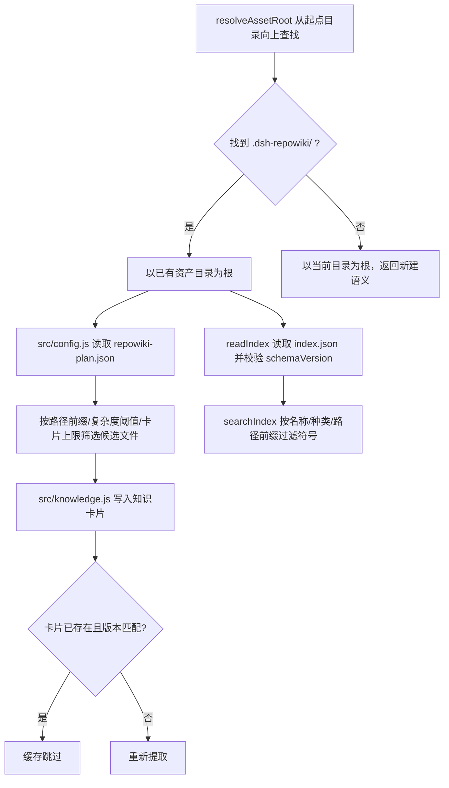

---
{
  "schemaVersion": 1,
  "title": "资产目录与配置管理",
  "slug": "assets-and-config",
  "locale": "zh",
  "generatedAt": "2026-11-26T07:08:54.834Z"
}
---
# 资产目录与配置管理

本页介绍 dsh-repowiki 的资产层三个模块：`src/assets.js` 负责定位 `.dsh-repowiki/` 资产目录并读写索引，`src/config.js` 负责读取项目级配置并筛选候选文件，`src/knowledge.js` 负责知识卡片与 Wiki 页面的落盘、解析与枚举。

## 资产根定位与索引读写：src/assets.js

`src/assets.js` 通过依赖注入的 `ctx.fs` 服务定位 `.dsh-repowiki/` 资产目录、读写索引文件并检索索引内容，所有文件操作均未裸用 node fs。

核心行为包括：`resolveAssetRoot` 从起点目录向上查找已存在的资产目录，找不到则以当前目录为根返回新建语义；`readIndex` 读取索引并校验 `schemaVersion`；`searchIndex` 按名称、种类、路径前缀过滤索引中的符号。`schemaVersion` 校验失败与资产目录不存在是两种不同语义：前者是数据版本问题，后者触发新建流程。

## 项目级配置与候选筛选：src/config.js

`src/config.js` 从资产目录下的 `repowiki-plan.json` 读取项目级配置。该模块的容错策略是：文件缺失或损坏时分别回退默认值，并以 `source` 字段区分配置来源，不阻断提取流程。

此外它还根据路径前缀、复杂度阈值和卡片上限过滤候选文件清单，决定哪些源码文件进入卡片提取阶段。所有字段经 `arrayOfStrings` / `nonNegativeInt` 校验，非法值静默降级为默认或空——这与 `src/assets.js` 的版本校验共同构成了资产层的防御式边界。

## 知识卡片与 Wiki 页面读写：src/knowledge.js

`src/knowledge.js` 为 repowiki 工具提供知识卡片与 Wiki 页面的落盘、解析与枚举能力，所有文件操作同样通过注入的 `ctx.fs` 服务完成。

存储约定为：卡片以 slug 化的源文件路径命名，并按 `locale` 分目录存放；配合 JSON frontmatter 的 `schemaVersion` 校验实现版本化读写。它服务于两类场景：提取阶段的卡片写入与缓存跳过（已存在且版本匹配的卡片不再重复提取），以及生成阶段的卡片汇总（`generatePrompt` 需要读取全部卡片摘要）。

