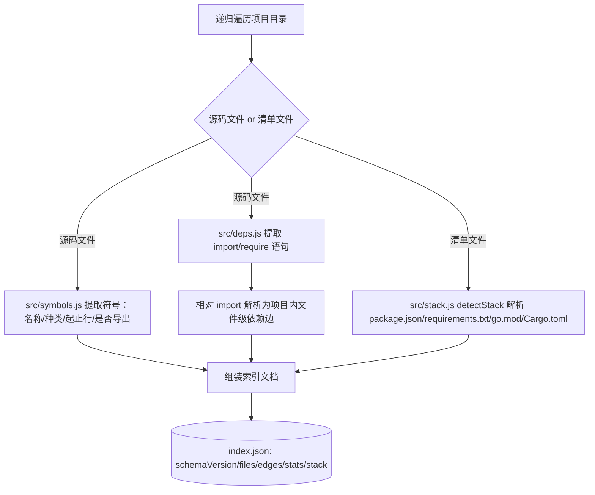

---
{
  "schemaVersion": 1,
  "title": "核心模块：索引构建与代码解析",
  "slug": "indexing-and-parsing",
  "locale": "zh",
  "generatedAt": "2026-11-26T07:08:54.833Z"
}
---
# 核心模块：索引构建与代码解析

本页介绍 dsh-repowiki 索引流水线的四个核心模块：编排器 `src/indexer.js`、符号提取器 `src/symbols.js`、依赖边提取器 `src/deps.js` 与技术栈识别器 `src/stack.js`。它们共同把仓库源码转化为结构化的符号级索引。

## 索引编排器：src/indexer.js

`src/indexer.js` 是仓库符号级索引的编排器，负责：递归遍历项目目录收集源码文件与清单文件；对每个源码文件提取符号与 import；把相对 import 解析为项目内文件级依赖边；最终组装成索引文档，包含 `schemaVersion`、`files`、`edges`、`stats`、`stack` 五个部分。

该模块有两个突出特性：整个流程完全确定性、不调用任何模型；fs 服务作为参数注入，便于单元测试。生成 `edges` 依赖的 import 提取能力由 `src/deps.js` 提供，符号级信息由 `src/symbols.js` 提供，`stack` 部分的清单文件文本则交给 `src/stack.js` 解析。

## 零依赖符号提取器：src/symbols.js

`src/symbols.js` 是 ADR-0001 定义的零依赖符号提取器，为 JavaScript/TypeScript 与 Python 源码提取符号级信息：名称、种类、起止行、是否导出，供 `index.json` 建立符号级检索与交叉引用。

它不做完整 AST，而是采用「行级关键字匹配 + 括号/缩进块匹配」的轻量解析策略，无法解析的边缘语法会被安静跳过。所有导出与内部函数均为纯函数：输入代码字符串与语言标识，输出符号数组，无副作用。

## 模块依赖边提取：src/deps.js

`src/deps.js` 提供从源码文本提取 `import` / `export-from` / `require` / `from-import` 语句的纯函数，每条记录包含 specifier、行号、引用形态与具名符号，用于建立文件级依赖边与交叉引用。

与 `src/symbols.js` 一致，目前仅支持 JavaScript/TypeScript 与 Python 两种语言，其他语言返回空数组——这意味着其他语言的源码文件不会贡献依赖边，但也不会中断索引流程。

## 技术栈识别：src/stack.js

`src/stack.js` 以纯函数 `detectStack` 为入口，从 `src/indexer.js` 已读取的清单文件文本（`package.json`、`requirements.txt`、`go.mod`、`Cargo.toml`）中提取项目名、版本与依赖列表，并按内置映射表输出命中的技术条目。

识别策略较为保守：未命中映射表的依赖只计入按生态汇总的 `dependencyCounts`，不产生技术结论；最终 `technologies` 列表按 `ecosystem:name` 去重，避免重复计数。

