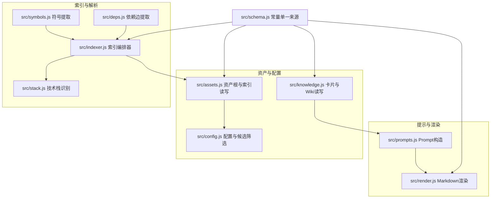

---
{
  "schemaVersion": 1,
  "title": "项目总览：dsh-repowiki 的模块组成与设计原则",
  "slug": "project-overview",
  "locale": "zh",
  "generatedAt": "2026-11-26T07:08:54.826Z"
}
---
# 项目总览：dsh-repowiki 的模块组成与设计原则

dsh-repowiki 是一套代码仓库 Wiki 生成工具，由 10 个源文件模块协作完成「索引构建 → 知识卡片提取 → Wiki 页面生成」的流水线。本页汇总各模块的职责边界与贯穿全项目的工程原则。

## 工具定位与模块清单

dsh-repowiki 的全部模块位于 `src/` 目录下，按职责可分为四组：

- **索引与解析**：`src/indexer.js`（索引编排器）、`src/symbols.js`（零依赖符号提取器）、`src/deps.js`（模块依赖边提取）、`src/stack.js`（技术栈识别）。
- **资产与配置**：`src/assets.js`（资产根定位与索引读写）、`src/config.js`（项目级配置与候选文件筛选）、`src/knowledge.js`（知识卡片与 Wiki 页面读写）。
- **LLM 提示与渲染**：`src/prompts.js`（子代理 Prompt 构造纯函数）、`src/render.js`（卡片与 Wiki 页面的 Markdown 渲染器）。
- **领域约定**：`src/schema.js`（常量与领域约定的单一来源）。

其中 `src/indexer.js` 负责递归遍历项目目录收集源码文件与清单文件，并把结果组装成索引文档（包含 `schemaVersion/files/edges/stats/stack` 字段），是整个流水线的起点。

## 领域约定的单一来源：src/schema.js

`src/schema.js` 是整个 bundle 的常量与领域约定单一来源，集中声明了：资产目录名、`index.json` 与知识卡片的 `schemaVersion`、默认排除目录、受支持语言映射、各工具的有界输出上限以及依赖边种类。

其余模块一律引用而非重复定义这些常量（遵循 DRY 原则）。例如 `src/render.js` 在写入卡片时即取自 `src/schema.js` 的 `CARD_SCHEMA_VERSION`，而 `src/assets.js` 的 `readIndex` 与 `src/knowledge.js` 的 frontmatter 解析也都依赖 `schemaVersion` 校验来实现版本化读写。这保证了索引、卡片、Wiki 三类产物在版本演进时的行为一致。

## 贯穿全项目的设计原则

从各模块的描述中可以归纳出四条一致的设计原则：

1. **确定性、零 LLM**：`src/indexer.js` 明确整个索引流程完全确定性、不调用任何模型。
2. **纯函数与无副作用**：`src/symbols.js`、`src/deps.js`、`src/stack.js`、`src/prompts.js`、`src/render.js` 的导出与内部函数均为纯函数，输入字符串、输出结构化数据。
3. **文件系统依赖注入**：`src/assets.js` 与 `src/knowledge.js` 的所有文件操作均通过注入的 `ctx.fs` 服务完成，不裸用 node fs；`src/indexer.js` 同样把 fs 服务作为参数注入以便单元测试。
4. **防御式校验与静默降级**：`src/config.js` 的所有字段经 `arrayOfStrings` / `nonNegativeInt` 校验，非法值静默降级为默认或空；文件缺失或损坏时不阻断提取。

