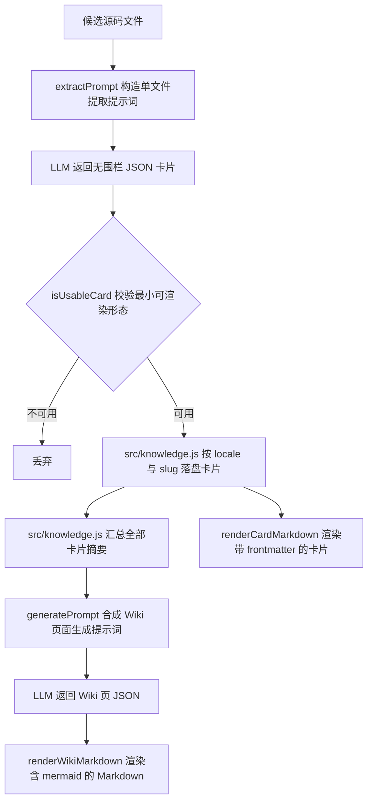

---
{
  "schemaVersion": 1,
  "title": "知识卡片提取与 Wiki 页面生成",
  "slug": "prompts-and-rendering",
  "locale": "zh",
  "generatedAt": "2026-11-26T07:08:54.835Z"
}
---
# 知识卡片提取与 Wiki 页面生成

本页介绍 LLM 集成的两个模块：`src/prompts.js` 构造自包含的子代理提示词（extractPrompt / generatePrompt / fenceLang），`src/render.js` 负责卡片与 Wiki 页面的 Markdown 渲染与最小可渲染校验，二者共同保证产物格式不依赖 LLM 输出的原始格式。

## 子代理 Prompt 构造：src/prompts.js

`src/prompts.js` 提供三个纯函数，为代码仓库 Wiki 流水线构造自包含的 LLM prompt：

- `extractPrompt`：为单文件知识卡片提取生成提示词；
- `generatePrompt`：把已提取的卡片摘要合成为 Wiki 页面生成提示词；
- `fenceLang`：负责选取代码围栏高亮语言。

所有 prompt 均要求模型只依据代码可证事实、不得臆造，并返回不带 markdown 围栏的 JSON。需要注意的职责边界是：token 预算与卡片裁剪由调用方控制，本模块不做截断——即 prompt 可能超出预算，截断逻辑在上层。

## Markdown 渲染器：src/render.js

`src/render.js` 提供三个纯函数：

- `renderCardMarkdown`：把知识卡片 JSON 渲染为带 frontmatter 的 Markdown；
- `renderWikiMarkdown`：把 Wiki 页 JSON 渲染为含 mermaid 图的 Markdown；
- `isUsableCard`：校验卡片数据是否满足最小可渲染形态。

frontmatter 采用 JSON 序列化，好处是零依赖解析且 Git diff 清晰；卡片写入时的 `schemaVersion` 取自 `src/schema.js` 的 `CARD_SCHEMA_VERSION`，不在此模块重复定义。

## 为什么渲染放在插件侧而非 LLM 侧

卡片与 Wiki 页面的 Markdown 格式由插件统一渲染，目的是避免子代理（LLM）输出格式漂移——LLM 只需返回结构化 JSON，格式由 `src/render.js` 确定性产出。

这与 `src/prompts.js` 的「返回不带 markdown 围栏的 JSON」要求相互呼应：prompt 约束模型输出结构，render 模块负责把结构转成最终 Markdown。两类产物的存储路径与版本校验则由 `src/knowledge.js` 承担，形成「提取 → 落盘 → 汇总 → 渲染」的完整闭环。

